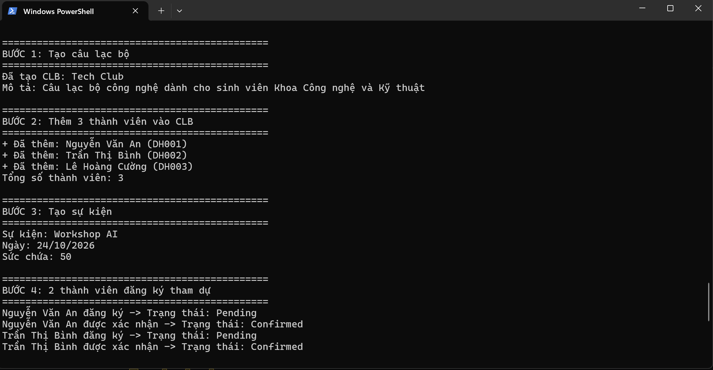
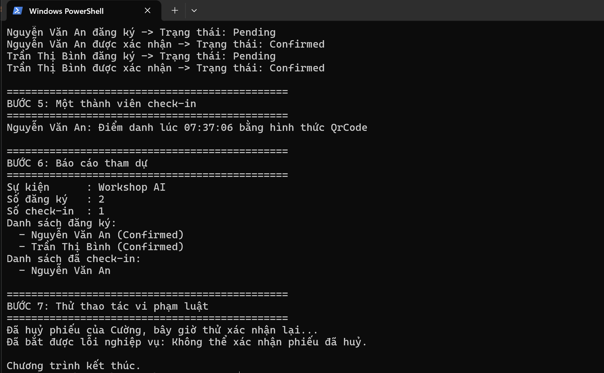

# EduHub – Ch01

Bài tập CH01 môn IN4211: phân tích yêu cầu và domain modeling cho hệ thống quản lý Câu lạc bộ & Sự kiện sinh viên.

## Mô tả thiết kế domain

- Gồm 5 class: `Club`, `Member`, `Event`, `Registration`, `CheckIn` (xem sơ đồ ở `docs/class-diagram.png`).
- `Registration` là bảng nối giữa `Member` và `Event` (quan hệ nhiều–nhiều).
- `CheckIn` thuộc về một `Registration` (quan hệ 1 – 0..1).
- Encapsulation: tất cả property dùng `private set`, constructor `private`, tạo đối tượng qua `Create()` có kiểm tra dữ liệu đầu vào.
- Trạng thái phiếu đăng ký và hình thức check-in dùng `enum` (`RegistrationStatus`, `CheckInMethod`), không dùng chuỗi rải rác.
- `Club` giữ danh sách thành viên dạng `IReadOnlyList<Member>` để bên ngoài không thêm trực tiếp, bắt buộc gọi `AddMember()` (có kiểm tra trùng).

## Cách chạy

Yêu cầu: .NET 10 SDK.

```bash
cd EduHub.Ch01
dotnet run
```

## Kết quả chạy




## Tài liệu

- [User Stories](docs/user-stories.md)
- [Class Diagram](docs/class-diagram.png)